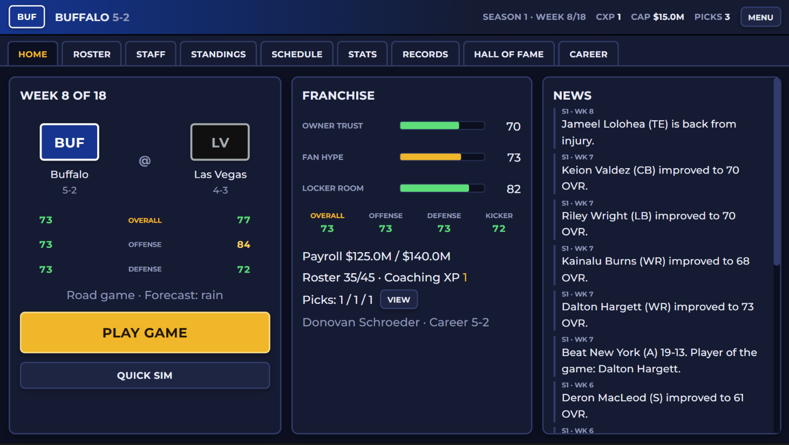
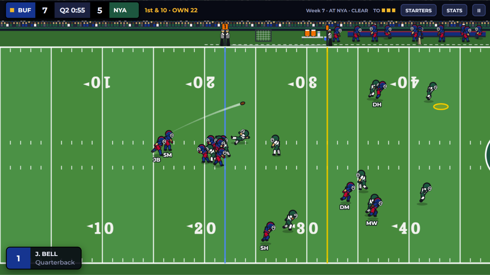
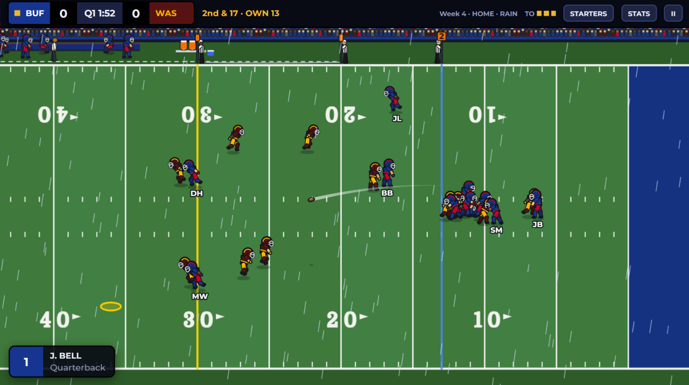
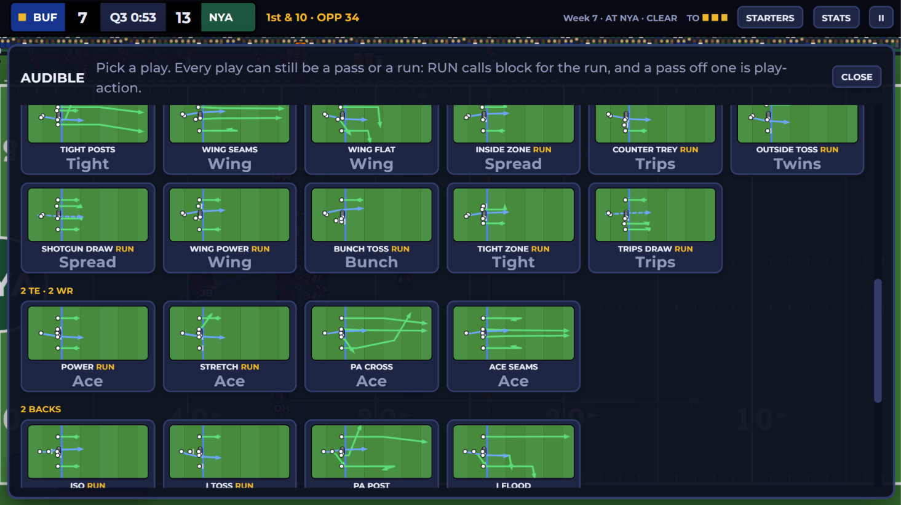

# Starting22

An American football franchise game for the browser. Take over one of 32 teams and run everything: the roster and depth chart, contracts under a salary cap, the draft, free agency, trades, staff and facilities. Then chase the League Championship.

**[▶ Play Starting22 (beta)](https://spicypark.github.io/Starting22/)**

## Features

**On the field**
- Play your offense live, snap to whistle: pass by pulling back and releasing, hand off, scramble, juke and dive
- A deep playbook in five personnel groupings, with audibles, play-action and run calls
- Player ratings that matter that affect their gameplay
- Timed field goals and extra points, punts, timeouts, hurry-up and the two-minute warning
- Pick your defense each drive (Balanced, Blitz or Prevent) and watch it play out
- Rain and snow games, overtime, fumbles, interceptions and injuries
- Personnel and starters/backups lineups, in-game stats, and a short tutorial
- Or quick sim any game

**The franchise**
- A 32-team league with an 18-week season, bye weeks and a 14-team playoff
- Roster, depth chart, player development, training and auto-train
- Salary cap, contracts, extensions and re-signing
- The draft (including trading up and down), free agency, trades, a trade block and a trade deadline
- Coaching Experience to spend on training, coordinators and facilities
- Press conferences, front-office events, fan hype and owner trust (run out and you're fired)
- League awards, records, a Hall of Fame, retired numbers and a season-by-season career history
- Up to 5 careers saved in your browser, with export and import

---

Copyright © 2026 spicypark. All rights reserved. This repository only showcases the game; its source code is private.
